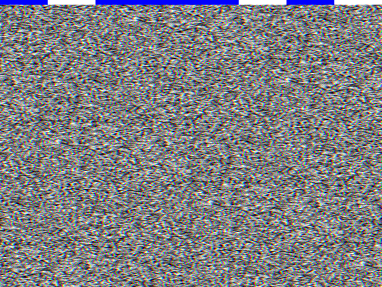
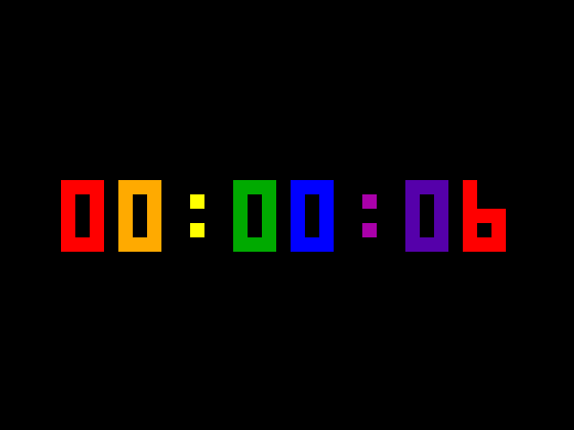

# Whole-frame capture at the real project clock, on fpga-4

Date: 2026-11-24. Board: fpga-4 (pi-sw2-p35, USB serial a2961e5cac65b25f,
RP2350, MicroPython b006887db6), lent by the `tt-harness-fpga-vga` session
under a claim file while fpga-1 had an outside client. Code: vgacap branch
`m6-frame` (PR mithro/vgacap#2), Milestone 6 Tasks 2 and 3.

Until today every capture ran the design slowed down (500 kHz here), because
streaming every sample over USB tops out near 750 kHz. `ttcap capture --mode
frame` runs the design at its real pixel clock, captures one frame into the
RP2350's SRAM and sends it between frames.

## Result

Every picture below is **pixel-identical to the design's reference render**
(`tt-vga-testpatterns/tools/compare_capture.py`), each a whole frame from one
captured frame unless noted:

| design | mode | project clock | system clock | pictures | result |
|---|---|---|---|---|---|
| tt_um_vgacal_bars | 640x480@60 | 25 MHz | 100 MHz | 2 | exact |
| tt_um_vgacal_grid | 640x480@60 | 25 MHz | 100 MHz | 2 | exact |
| tt_um_vgacal_counter | 640x480@60 | 25 MHz | 100 MHz | 2 (frames 8, 41) | exact |
| tt_um_vgacal_prbs | 640x480@60 | 25 MHz | 100 MHz | 2 (frames 69, 102) | exact |
| tt_um_vgacal_modes ui_in=0 | 640x480@60 | 25 MHz | 100 MHz | 1 | exact |
| tt_um_vgacal_modes ui_in=1 | 800x600@60 | 40 MHz | 80 MHz | 1 (two windows) | exact |
| tt_um_vgacal_modes ui_in=2 | 720x400@70 | 28.25 MHz | 113 MHz | 1 | exact |
| tt_um_vgacal_modes ui_in=4 (hsync inverted) | 640x480@60 | 25 MHz | 100 MHz | 1 | exact |
| tt_um_vgacal_modes ui_in=8 (vsync inverted) | 640x480@60 | 25 MHz | 100 MHz | 1 | exact |
| tt_um_vgacal_grid, `--mode window` (48 lines) | 640x480@60 | 25 MHz | 100 MHz | 1 (11 frames) | exact |
| tt_um_vgacal_counter, `--mode window` | 640x480@60 | 25 MHz | 100 MHz | 1 (11 frames) | torn, 1,040 px, as expected |

`designs-25mhz.log`, `modes.log`, `window.log`. The board measured every
sync polarity itself (its `frame ... hsync_active= vsync_active=` TIME
message), including the inverted ones.

The windowed counter picture is torn by design: its 11 windows come from 11
different frames and the counter changes every frame. `ttcap` now says so
after the stats (`window-counter-note.log`): "note: each picture is
assembled from 11 captured frames (48 of its 481 lines per frame): exact for
a static design, torn for one that changes from frame to frame".

`tools/hil.py` with the new `frame` check: **10 checks, 10 passed**
(`hil-report.md`, `hil-run.log`).

## Real silicon: tt09 at its design clocks

The same code on the tt09 ASIC board (`tt-3b0880b48ee5c388`, pi-sw2-p10,
RP2350, MicroPython 670d775365, SDK 3.0.7), selecting each project through
`tt.shuttle` (`--project`), two pictures each, every one `partial=0
glitches=0` (`tt09-asic.log`):

| project | clock (system clock) | VGA mode | board-measured syncs |
|---|---|---|---|
| tt_um_rejunity_vga_logo | 25.175 MHz (101 MHz) | 640x480@60 | positive / positive |
| tt_um_a1k0n_nyancat | 25.175 MHz (101 MHz) | 640x480@60 | negative / negative |
| tt_um_vga_clock | 31.5 MHz (126 MHz) | 640x480@72 | negative / negative |

There is no reference render for these, so they are judged by eye and by
reconstruction: clean pictures, and the VGA clock reads 00:00:06, the
seconds since the capture released reset -- the chip was running at its
real clock, which slowed-down streaming could never show. This board's heap
gave 434-451 lines, so each picture is two captured frames, and `ttcap`
says so.

## What it took, in the order the board taught it

1. **The sample point.** The first capture at 25 MHz had 4,287 wrong pixels
   (1.4%), all at colour changes. The SDK runs the RP2350 at 100 MHz for a
   25 MHz project clock, 4 system clocks a pixel, and `uo_out` changes about
   2-3 of them (~25 ns, FPGA + pads + synchroniser) after each rising edge,
   right where the falling-edge sampler read it. Sweep
   (`sweep-bars-25mhz.log`):

   | edge \ delay | +0 | +1 | +2 | +3 |
   |---|---|---|---|---|
   | falling | 4,287 px wrong | exact | no picture | no picture |
   | rising | **exact** | 30,240 px wrong | no picture | no picture |

   Frame modes now default to rising+0, the middle of the two-point window.
2. **The heap.** 481 lines x 800 one-byte samples is 385 KB; fpga-4 has
   ~420 KB free but its largest block is ~142 KB. One DMA channel per heap
   block ran out of channels (15 buffers: 473 lines) before heap, and the
   last 8 lines then came from a later frame -- a torn prbs picture, 22,068
   wrong pixels, all in the second window. Control-block DMA (a control
   channel loads (read, write, count, CTRL_TRIG) blocks from a table into a
   data channel) takes 20-25 blocks through two channels: 481 lines, one
   frame.
3. **800x600 at 40 MHz** is 2 system clocks a pixel, too few for a
   wait-for-edge loop. The SDK's clocking is jitter-free (system clock a
   whole multiple of the project clock: 4x at 25/31.5 MHz, 2x at 36/40 MHz,
   28.322 -> 28.25 = 113/4), so the sampler syncs to one edge and then runs
   free, `in pins [P-1]`, phase-locked to the PWM.
4. **Inverted hsync** left the first line of a second window a pixel off
   (64 px, ui_in=4): libvgaframe took the pulse level from the mode table.
   It now takes it from the window's first sample.

Each of these is now covered by an emulator test (vgacap `ttcap.emu`, which
runs the exact built board script) or a C test in libvgaframe, and each such
test was checked to fail without its fix.

## Fixed after these runs

In frame mode `vgacap-frames` printed the *mode table's* sync polarities
(`modes.log`, ui_in=4 and 8 show `hsync=neg vsync=neg`). libvgaframe now
measures them over the picture (vgacap PR #2); re-run on the same streams it
reports ui4 hsync=pos, ui8 vsync=pos, ui1 pos/pos, ui2 neg/pos, ui0 neg/neg.
