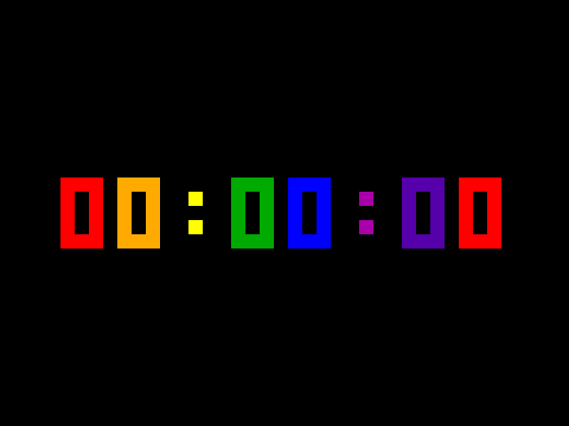

# PIO run counting on tt09 silicon: identical to RAW

Date: 2026-11-24.
- **Board:** tt09 ASIC (pi-sw2-p10, USB serial 3b0880b48ee5c388, SDK 3.0.7),
  through the daemon's bridge (`fpgas-tt` not stopped).
- **Code:** vgacap PR #6 (`ttcap capture --mode rle`).
- **Design:** `tt_um_vga_clock` (640x480@60 here), at a 100 kHz project
  clock.

At that clock the design's digits change only every 31.5 M clocks, which
is minutes, so two captures taken back to back must show the same
picture. That makes a check that needs no reference render:

| capture | board | samples | frames |
|---|---|---|---|
| `--mode stream` (RAW), 14 s | overruns 0, rxstall 0 | 1,376,256 | 2, 0 glitches |
| `--mode rle`, 14 s | style=edge period=1500, overruns 0, rxstall 0 | 1,513,243 | 2, 0 glitches |

All four pictures are pixel-identical: 0 differing pixels (`compare.log`).
That completes the PIO run counter's hardware runs: an FPGA design on
fpga-4, exact up to 25 MHz, and silicon here.

Afterwards the SDK was restarted and `fpgas-tt` restarted at 0 clients,
back to its pre-existing safe-start state.
